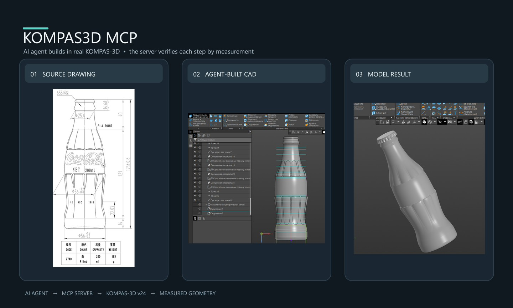
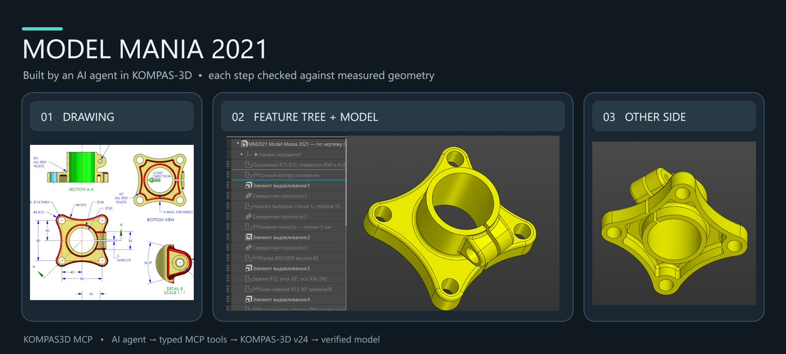
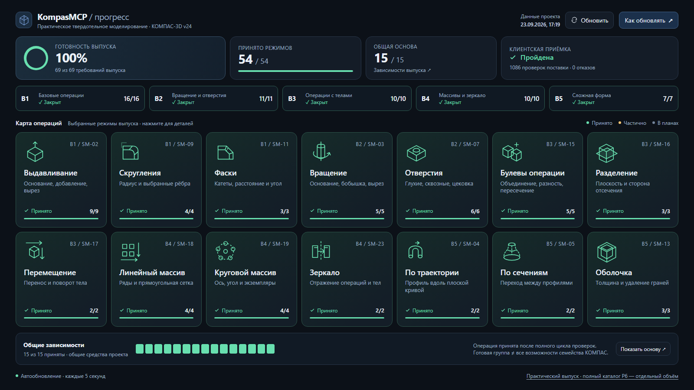

# Kompas3D MCP

**MCP-сервер для КОМПАС-3D v24: ИИ-агент строит и проверяет настоящие детали и сборки, а сервер
отвечает тем, что измерил на модели, а не тем, что вызов «прошёл».**

[](LICENSE)




Подключите сервер к ИИ-агенту (Codex, Claude или другому MCP-клиенту), и агент будет работать в
вашем КОМПАС-3D: строить детали по чертежу, править их, собирать сборки, выпускать чертежи и
выгружать STEP и DXF. После каждого шага сервер перечитывает модель и сообщает, что именно
подтверждено измерением.

> *English summary.* An MCP server that lets an AI agent drive a real, licensed KOMPAS-3D v24 (x64):
> parts, sketches, features, assemblies and mates, drawings, sheet metal, STEP/DXF export. Every
> mutating call reports a measured verification level, is journaled for safe retries and is confined
> to configured disk roots. No arbitrary code execution. Dual-licensed MIT / Apache-2.0.
> Documentation is in Russian.

## Быстрая установка

Нужны Windows x64, установленный и лицензированный **КОМПАС-3D v24 x64** и **.NET 10 Runtime x64**.
Скопируйте агенту одну фразу - он сам скачает пакет из Releases, сверит контрольную сумму, создаст
конфигурацию и подключит сервер. Разрешите ему скачивание и запуск установщика, когда он спросит.

<p>
  <picture>
    <source media="(prefers-color-scheme: dark)" srcset="docs/assets/openai-blossom-white-tight.svg">
    
  </picture>
  &nbsp;&nbsp;<b><a href="https://developers.openai.com/codex">ChatGPT Codex</a></b>
</p>

```text
https://github.com/SergeySklyarov/Kompas3D-MCP
Установи и подключи последнюю принятую версию KompasMCP из этого репозитория на этой Windows-машине по инструкции docs/operator-guide/codex-setup.md; проверь зависимости, checksum и доступность инструментов; мои модели не изменяй.
```

<p>
  
  &nbsp;&nbsp;<b><a href="https://code.claude.com">Claude Code</a></b>
</p>

```text
https://github.com/SergeySklyarov/Kompas3D-MCP
Установи и подключи последнюю принятую версию KompasMCP из этого репозитория на этой Windows-машине по инструкции docs/operator-guide/claude-setup.md; проверь зависимости, checksum и доступность инструментов; мои модели не изменяй.
```

После установки перезапустите клиент и в новом чате попросите «вызови kompas_health и
kompas_capabilities»: сервер ответит версией и списком инструментов. Подробно:
[Codex](docs/operator-guide/codex-setup.md), [Claude](docs/operator-guide/claude-setup.md),
[другой MCP-клиент и ручная установка](docs/operator-guide/install.md),
[сборка из исходников](docs/operator-guide/build.md).

## Пример: деталь по чертежу, собранная агентом

Агенту дают чертёж и задачу, и он строит деталь сам, вызовами инструментов этого сервера. Каждый
шаг сервер подтверждает измерением.



*Слева чертёж задания конкурса **Model Mania 2021** (SOLIDWORKS; права на чертёж принадлежат
SOLIDWORKS). В центре дерево построения в КОМПАС-3D, которое агент (**ChatGPT 6.0 Astra, режим
размышлений Low**) собрал сам, и модель; справа та же деталь с обратной стороны.*

## Что умеет

- **Детали.** Эскизы, выдавливание, вращение, по траектории и по сечениям, оболочка, скругления,
  фаски, отверстия, резьба, уклоны, булевы операции, массивы.
- **Правка, а не пересоздание.** Параметры существующего признака читаются и меняются на месте;
  признак можно подавить, восстановить или удалить.
- **Сборки.** Вставка, замена и размещение компонентов, сопряжения, разнесённый вид, сечения,
  проверка пересечений и зазоров.
- **Листовой металл.** Листовое тело, сгибы, отверстия и вырезы, развёртка и её выгрузка в DXF.
- **Чертежи.** Ассоциативные виды, разрезы, размеры, основная надпись, технические требования,
  экспорт в DXF/DWG.
- **Переменные и материал.** Внешние переменные и привязка к ним параметров; материал, плотность и
  масса.
- **Измерение и обмен.** Габарит, объём, центр масс, грани и рёбра; экспорт и импорт STEP, экспорт
  STL, снимок модели картинкой прямо в чат.



*Дашборд приёмки по профилю `mechanical-core-v1` (снимок 23.09.2026): каждый режим инструмента
подтверждается живым прогоном. Иллюстрация, а не источник чисел - действующие числа в
[состоянии и планах](docs/project-status.md).*

Чего пока нет и что в работе: [состояние и планы](docs/project-status.md).

## Почему ему можно доверять

Каждая операция возвращает измеренный уровень проверки и список того, что проверить не удалось.
Повтор операции не применяет её дважды, устаревшие ссылки отвергаются, а не указывают на чужой
объект. Сервер пишет только в разрешённые каталоги, не выполняет произвольный код и пользуется
только документированным API КОМПАС. Подробно: [как устроено](docs/how-it-works.md).

## Документация

[Карта документации](docs/INDEX.md) · [инструменты](docs/TOOLS.md) ·
[состояние и планы](docs/project-status.md) · [как устроено](docs/how-it-works.md) ·
[обзор проекта](KOMPAS3D_MCP.md)

## Лицензия

[MIT](LICENSE-MIT) или [Apache-2.0](LICENSE-APACHE) на выбор получателя ([LICENSE](LICENSE)).
КОМПАС-3D является продуктом АСКОН и в репозиторий не входит; для работы нужна собственная лицензия.

<sub>ChatGPT, Codex и логотип OpenAI являются товарными знаками OpenAI; Claude и логотип Claude -
товарными знаками Anthropic. Проект не связан с OpenAI и Anthropic и не одобрен ими.</sub>
